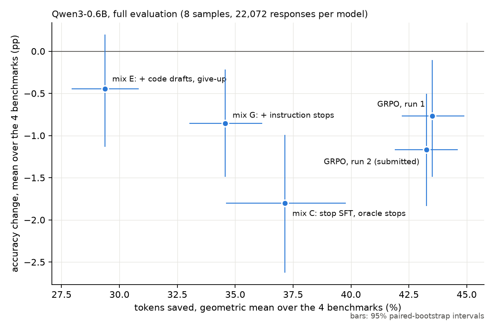

# Where the Thinking Stops Mattering

**Teaching a 0.6B reasoning model when to stop thinking**

Jan Herza · Independent research · October 2026

**Result: 43.3% fewer tokens [41.9, 44.6] at −1.17 pp accuracy [−1.83, −0.50]** (the submitted
`results.json`: unmodified `evaluate.py`, 8 samples, 22,072 responses, paired bootstrap). A second
full run of the same adapter gave 43.5% / −0.77 pp; only 6,092 of the 22,072 responses are
identical, because vLLM generation is not bit-reproducible across runs, so read the accuracy as
"about −1 pp". A LoRA (r = 16) on Qwen3-0.6B: stop-point distillation on the model's own reasoning,
then GRPO with a domain-normalised length penalty. Prompts, sampling, token caps and thinking mode
unchanged.

| Benchmark | Tokens saved | Accuracy change |
| --- | ---: | ---: |
| MBPP+ | 64.7% [62.5, 66.8] | −1.72 pp [−3.31, −0.17] |
| IFEval | 38.9% [35.1, 42.5] | −0.65 pp [−2.31, +1.09] |
| BFCL simple / multiple / irrelevance | 25.8% / 35.3% / 33.9% | −1.00 / −0.56 / −0.83 pp (intervals cover 0) |
| SVAMP | 30.7% [28.3, 33.0] | −1.45 pp [−2.29, −0.66] |
| **Average** | **43.3%** | **−1.17 pp** |
| *Average, other full run* | *43.5%* | *−0.77 pp* |

Submitted checkpoints along the length/accuracy curve (all full evaluations):

| Checkpoint | Tokens saved | Accuracy change |
| --- | ---: | ---: |
| `stoppoint_mixE`: stop SFT, conservative | 29.4% [27.9, 30.8] | −0.45 pp [−1.13, +0.20] (every interval covers 0) |
| `stoppoint_mixG`: stop SFT + instruction data | 34.6% [33.0, 36.2] | −0.85 pp [−1.49, −0.21] |
| **`grpo`: GRPO from mix G** | **43.3% [41.9, 44.6]** | **−1.17 pp [−1.83, −0.50]** (other full run −0.77) |

**Held-out check.** Every design decision was made while looking at the four benchmarks (never
training on them). On HumanEval, which played no part in any decision, the final adapter saves
**65.0% [62.0, 67.9] at −1.22 pp [−5.03, +2.74]** (164 tasks × 4), the same as on MBPP+. GSM8K test
saves 44%, but it shares source and prompt format with the training data, so its large accuracy gain
(the base model fails the strict answer format and hits the cap there) says nothing about
generalisation.

## Motivation

I first measured where the base model's tokens go (22,072 responses):

- **The cost sits in a tail that never finishes.** 7.9% of MBPP+ responses hit the cap and hold
  30.6% of MBPP+ tokens, all scored wrong; 98% of them are cut off inside `<think>`, still
  reasoning, not looping. The metric is a ratio of sums, so this tail dominates it.
- **Longer is worse.** Accuracy falls from the shortest to the longest fifth of responses: MBPP+
  80% → 14%, SVAMP 96% → 69%.
- **The model knows the answer before it stops.** Forcing `</think>` at paragraph boundaries of its
  own GSM8K reasoning: with 60% of the thinking it answers right 80% of the time (87% with all of
  it); the median rollout could stop after 30%. The point varies per answer, so a fixed budget
  cannot capture it; a learned stop can.

## Method

**Stage 1, stop-point distillation (SFT).** Sample the base model on training tasks with automatic
verifiers; in each rollout find, by binary search over paragraph boundaries, the earliest cut where
a forced `</think>` still yields a verified answer (2 probes + 4 verification samples); train on
the model's *own* reasoning up to the cut + `</think>` + its own answer. Three rules turned out to
be necessary, each found by reading failures:

1. **Code: stop only after the function is written out in the reasoning.** Plain oracle stops let
   the model stop after a one-paragraph plan and write untried code straight into the answer
   (`return [{}, {}, {}, {}, {}]` for "N empty dicts"); MBPP+ −5.4 pp. Requiring a drafted `def`
   before the cut recovered it.
2. **Give up with a best guess.** Rollouts that hit the cap are cut at 2,048 thinking tokens and end
   with the model's own forced answer (right if it already knows, else its best well-formed guess,
   never a refusal). Capped MBPP+ responses fell from 49 to 6 per 756 at no accuracy cost.
3. **Instruction following needs its own verifiable data.** Dolly instructions with five format
   constraints IFEval does *not* use (no digits, Markdown table, emoji count, end with a question,
   "!"-terminated sentences) as the verifier. IFEval's median reasoning fell 296 → 134 tokens with
   no accuracy loss.

Data: GSM8K train, KodCode-Light-RL-10K, Glaive function calling v2, databricks-dolly-15k. All
overlap-checked against every evaluation question (8-gram); 11 Glaive rows removed. KodCode is
built from LeetCode, Codeforces, APPS, TACO and synthetic sources, not from MBPP; 39 of its tasks
share a generic function name with an MBPP+ task (`shell_sort`, `is_perfect_square`, …), none
shares more than 54% of the MBPP+ task's words.

**A grey zone, disclosed.** IFEval's capped answers are mostly "wrap your entire response in double
quotation marks" failing to close. I added 2,500 Dolly prompts with *other* wrappers (`<reply>`
tags, square brackets, a fenced block) to the GRPO instruction pool, so that a looping reply earns
0. No IFEval prompt, constraint text or verifier is used, and the double-quote wrapper itself is
not, but the idea came from reading IFEval failures and the structure (open, write, close) is
shared with one IFEval constraint type. The stage-1 checkpoints (`stoppoint_mixE`,
`stoppoint_mixG`) contain no wrapper data.

**Stage 2, GRPO.** From the stage-1 adapter: 50 steps × 24 prompts × 8 samples over the same four
pools (plus the wrapper prompts above), one run, no hyperparameter search, reward `1[correct] · (1 − 0.2 · L / mean L of the domain)`, group-mean advantage, one
on-policy update per batch, no KL. Normalising length per domain (not per question) matches the
metric; a wrong or capped answer earns 0 regardless of length. Stage 1 could not shorten SVAMP
without losing accuracy (every attempt traded ~1 pp per 8 points of saving): the model's re-checks
after reaching an answer sometimes catch errors. GRPO learned to keep the useful ones: SVAMP saving
14% → 31% at the same accuracy (−1.20 → −1.21 pp).

## What did not work

| Idea | Result (quick 2-sample evaluation) |
| --- | --- |
| SFT on the shortest correct own rollout (reference) | +2.3%, −0.53 pp: almost no signal |
| Math stop points (oracle) | SVAMP +37% but −2.3 pp: the model commits to the first number |
| Later stops by a fixed or difficulty-based margin | less saving, same SVAMP loss |
| Scaling the adapter to 0.75 / 0.5 strength | the stop disappears: a switch, not a dial |
| DPO on "later correct vs earlier wrong" stop pairs | the learned stop collapsed (MBPP 762 → 1,769 tokens) |
| Stops only after a "check" cue | cues fired on restating the task's test; no gain |
| Math stops only after the answer is computed | SVAMP −6.1 pp (86% of stops already were) |
| Math give-up at 1,024 tokens | SVAMP saving ×2 at −1.5 pp |
| Distractor sentences in math training data | SVAMP still −5 pp |
| Cutting looping replies (own wrapper constraints) | wrapper loops start at the first token; nothing to cut |

## What I learned

- The metric rewards cutting the tail, not trimming every answer evenly.
- Where an oracle says "the answer is already right" is not where the model *knows* it is: stop
  data must follow the model's own work (a drafted function, a finished computation it can trust).
- Stop SFT is all-or-nothing per behaviour; deciding *when* a check is worth it needed RL.
- Quick 2-sample evaluations disagree by 1–2 pp per benchmark between identical-data runs; only the
  8-sample evaluation ranks close checkpoints.

## Hardware and compute

One RTX 5060 Ti (16 GB, Blackwell) under WSL2 Ubuntu 24.04. PyTorch 2.11 (CUDA 13.0), vLLM 0.23,
transformers 4.57.1, peft 0.17.1. About 65 GPU-hours for everything including failed variants;
the final pipeline alone (rollouts, stop search, SFT, GRPO) about 12 GPU-hours. GRPO shares the GPU
between vLLM generation (35%) and training.
