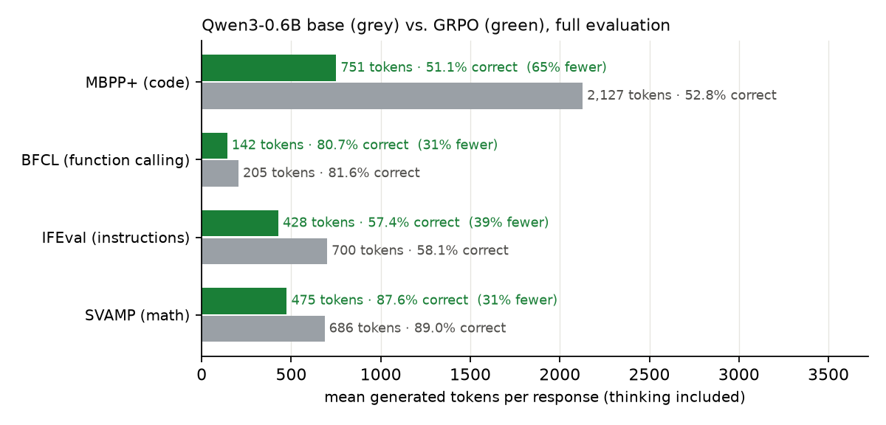

# Where the Thinking Stops Mattering

Small reasoning models often reach the right answer and then keep thinking anyway. The models waste tons 
of tokens re-checking something they already did, planning something they will never do or repeating nonsense until the
token limit. This project teaches Qwen3-0.6B to stop where its own thinking stops mattering, with
the change in the weights only. Benchmarked on the same prompts, same sampling, same token limits, thinking still on.

**Final result is about 43% fewer generated tokens at about −1 pp accuracy**, measured on 22,072
responses over four benchmarks (code, function calling, instruction following, arithmetic). Two full
evaluations gave +43.3% / −1.17 pp and +43.5% / −0.77 pp. vLLM generation is
not perfectly reproducible across runs, so the spread between them is part of the result. On HumanEval,
which played no part in development, the saving is 65% at −1.2 pp.

Student project, October 2026, on one RTX 5060 Ti (16 GB). Negative results are kept
below with the positive ones. Most of what was tried did not work, and why it did not is most of
what was learned.

<p align="center">
  
</p>

<sub>Real outputs from the evaluation run, the same task for both models, streamed at the same number of tokens per second. The example is the pair closest to the benchmark's median length ratio among long base answers, not a hand picked extreme
(`analysis/demo_svg.py`). A math example: [figures/demo_svamp.svg](figures/demo_svamp.svg).</sub>

## Result

| Benchmark | What it tests | Tokens saved | Accuracy change |
| --- | --- | ---: | ---: |
| MBPP+ | writing a Python function | **64.7%** [62.5, 66.8] | −1.72 pp [−3.31, −0.17] |
| IFEval | following format instructions | **38.9%** [35.1, 42.5] | −0.65 pp [−2.31, +1.09] |
| BFCL (3 subsets) | function calling | **26–35%** | −0.56 to −1.00 pp (all intervals cover 0) |
| SVAMP | grade-school arithmetic | **30.7%** [28.3, 33.0] | −1.45 pp [−2.29, −0.66] |
| **Average** | | **43.3%** [41.9, 44.6] | **−1.17 pp** [−1.83, −0.50] |
| *Average, other full run* | | *43.5%* [42.2, 44.9] | *−0.77 pp* [−1.49, −0.10] |

Tokens saved is the evaluation's own metric: per benchmark one minus the ratio of summed tokens, 
then the mean over benchmarks. Accuracy change is the mean over benchmarks. 8 samples per question. The
per-benchmark rows are the run made with the unmodified `evaluate.py` (its `results.json` is the
submitted one); only 6,092 of 22,072 responses are identical between the two runs.

<p align="center"></p>

What the numbers fail to show, is that the the accuracy loss is concentrated in SVAMP and MBPP+, whose
intervals exclude zero in one of the two runs. Every design decision was made while looking at
these four benchmarks (never training on them), so the selection may flatter them; the
[held-out check](#held-out-check) on HumanEval shows the code result carrying over.

## What I built

A method with two stages, both trained as a LoRA (r = 16) on the models own outputs.

1. **Stop-point distillation**. For each training task, sample the base models own
   reasoning, force `</think>` at paragraph boundaries, and find the earliest cut where the forced
   answer is right. Train on *own reasoning up to that cut + `</think>` + answer*. Three rules
   were needed to keep accuracy, each found by analyzing failures:
   - **Stop only after the function is written out in the reasoning.** Oracle stops let the
     model stop after a one-paragraph plan and write untried code into the answer (MBPP −5.4 pp);
     requiring a drafted `def` before the stop brought MBPP back.
   - **Give up with a best guess after a long, bad attempt.** Attempts that run to the token limit
     are wrong anyway and hold a third of the base models code tokens. Cutting them at 2,048
     thinking tokens with the models own best answer cut capped MBPP responses from 49 to 6 per
     756, with no accuracy cost.
   - **Instruction following needs its own verifiable data.** Dolly instructions with format
     constraints of five types IFEval does not use (no digits, Markdown table, emoji) halved
     IFEval's reasoning length (296 → 134 median tokens) with no accuracy loss.
2. **GRPO** from that adapter, with reward `1[correct] · (1 − α · length / domain mean length)`:
   the length penalty is normalised per domain because the metric is a ratio of sums, and a wrong
   or capped answer earns 0 whatever its length. Supervised stops cannot teach *when* re-checking
   pays off; on arithmetic the model's checks sometimes catch an error and sometimes are waste.
   RL learned to keep the useful ones: SVAMP's saving went from 14% to 31% at the same accuracy.

Training data consisted of the following: GSM8K train, KodCode-Light-RL-10K, Glaive function calling v2, 
databricks-dolly-15k. Every source was checked for overlap with evaluation questions and
11 overlapping function-calling questions were removed. One grey zone disclosed is that the GRPO instruction
pool also holds dolly prompts with wrapper constraints (`<reply>` tags, brackets, a fenced block),
added after reading IFEval's failures, whose loops mostly come from its "wrap in double quotes"
constraint. No IFEval prompt, constraint or verifier is used; the structure is shared.

## What is new here

1. **Where an oracle says the answer is right is not where the model knows it.** Stops placed at the
   earliest point where a forced answer passes the tests teach the model to stop *before doing the
   work*: on code it stopped drafting the function in its reasoning (98% → 8% of answers) and wrote
   untried code (MBPP+ −5.4 pp). Constraining the stop to come after the models own draft fixes it.
   The failure is invisible on the training distribution and shows only on a related benchmark.
2. **A controlled SFT-vs-RL comparison on one behaviour: re-checking an answer already reached.** On
   arithmetic, every variant of stop data that shortened SVAMP by 19–48% (stop margins, later cut
   rules, give-up budgets) cost 1.5–6.1 pp of its accuracy; the checks are not waste for a 0.6B model.
   GRPO from the same model and data pools broke that trade (SVAMP saving 14% → 31% at about the same
   accuracy: −1.21 and −1.45 pp in the two runs against −1.20 pp before), consistent with learning to
   check selectively, which per-example stop targets cannot express.
3. **Stop distillation beyond math, with verifiers that avoid the evaluation's own data**: unit tests
   for code, call matching for function calling, and format constraints of types IFEval does not use
   for instruction following. The last transferred to IFEval's planning length (median reasoning
   296 → 134 tokens) at no accuracy cost; math stop data, in contrast, transferred to nothing.
4. **Two smaller observations.** A learned stop behaves like a switch: scaling the LoRA down to 0.75
   or 0.5 removes it entirely instead of giving a shorter-but-safer model. And because the metric is
   a ratio of sums, a handful of attempts that run to the cap dominate it, which makes "give up with
   a best guess" worth as much as any reasoning-level change on code.

## Along the way

<p align="center"></p>

| Checkpoint (full evaluation) | Tokens saved | Accuracy change |
| --- | ---: | ---: |
| Shortest correct own answer, SFT (reference baseline; quick eval) | 2.3% | −0.53 pp |
| Mix C: oracle stops on math, code, tools | 37.2% | −1.80 pp |
| Mix E: + code drafts, give-up | 29.4% | −0.45 pp (all intervals cover 0) |
| Mix G: + instruction stops | 34.6% | −0.85 pp |
| **GRPO from mix G** (two runs) | **43.3% / 43.5%** | **−1.17 / −0.77 pp** |

What did not work, each on the evaluation's quick 2-sample run unless noted:

| Idea | Result | Why |
| --- | --- | --- |
| DPO on "later correct vs earlier wrong" stop pairs | learned stopping collapsed (MBPP 762 → 1,769 tokens) | preference pairs undid the stop instead of sharpening it |
| Stop only after the model "checked" its answer (cue words) | no accuracy gain, fewer savings | the cues fired on the model restating the task's test case |
| Math stops only after the answer is computed | SVAMP −6.1 pp | 86% of stops already were; the re-checks after the answer are what keep it right |
| Give up on math after 1,024 tokens | SVAMP saving ×2 at −1.5 pp | long correct attempts get cut before they know |
| Scaling the adapter's strength (×0.75, ×0.5) | the stop vanishes entirely | a learned stop is a switch, not a dial |
| Math with irrelevant distractor sentences | SVAMP still −5.2 pp | the loss came from the math stop data itself, not from distraction |
| Cutting looping replies (Dolly, own wrapper formats) | 7 usable examples | plain instructions rarely loop; wrapper loops start at the first token, leaving nothing to keep |

## Held-out check

Two sets that played no part in any decision, base against GRPO (`analysis/heldout_eval.py`):

| Set | Tokens saved | Accuracy change |
| --- | ---: | ---: |
| HumanEval (164 tasks × 4) | **65.0%** [62.0, 67.9] | −1.22 pp [−5.03, +2.74] |
| GSM8K test (500 × 2) | 44.3% [41.8, 47.0] | +35.2 pp strict, +10.9 pp lenient |

HumanEval is the real held-out test: different tasks from MBPP+, never looked at, and the MBPP+
result carries over almost exactly. GSM8K test holds out questions but not the distribution (same
source and prompt format as the GSM8K training data), so its accuracy gain is not generalisation:
the base model fails the strict `Final answer:` format on a quarter of the answers it knows and
hits the token cap on 27.5% of them; the trained model learned the format and to finish.

## How the repository is laid out

| Path | Contents |
| --- | --- |
| `stopping/` | the method: rollouts, stop search, verified/draft stops, give-up and constraint data, LoRA and GRPO trainers, graders and the code sandbox |
| `analysis/` | measurements and figures: forced-stop sweep, overlap check, held-out check, plots, demo |
| `scripts/` | resumable full evaluation, subsampled baselines, adapter scaling |
| `evaluate.py`, `compare.py`, `utils/` | the evaluation harness, unchanged from the original test |
| `figures/` | everything shown here |

## Reproduce

```bash
python utils/eval/benchmarks.py                                   # freeze the evaluation questions
python scripts/resumable_eval.py --out runs/base                  # baseline (~3 h on a 5060 Ti)

# stop-point data per domain (math shown; code, tools and constraints the same way)
python stopping/generate_rollouts.py --out runs/rollouts_gsm8k --sources gsm8k --questions 1500
python stopping/find_stop_points.py runs/rollouts_gsm8k --out runs/stop_points
python stopping/verified_examples.py runs/rollouts_code runs/stop_points_code --mode draft --out runs/verified_code_draft
python stopping/give_up_examples.py runs/rollouts_code --out runs/give_up_code --budget 2048

# mix G = draft code stops (one per question) + give-up rows + tool and math rows + constraint stops, concatenated
python stopping/train_lora.py --data runs/train_mixG.jsonl --out checkpoints/stoppoint_mixG
python stopping/train_grpo.py --init checkpoints/stoppoint_mixG --out checkpoints/grpo --steps 50 --prompts 24
python evaluate.py --out runs/grpo --adapter checkpoints/grpo
python compare.py runs/base runs/grpo
```

Compute for everything in this repository, including all failed variants: about 65 GPU-hours on
one RTX 5060 Ti.

## Origin

This project started as a response to the
[ThinkingCap Test](https://github.com/BottleCapAI/ThinkingCap-Test) by BottleCapAI.
The evaluation harness (`evaluate.py`, `compare.py`, `utils/`), `train.py` and the original task description
([CHALLENGE.md](CHALLENGE.md)) come from that repository and are licensed under Apache-2.0 (see [LICENSE](LICENSE)).
The benchmarks and training datasets belong to their authors; see the sources table in
[CHALLENGE.md](CHALLENGE.md#sources-and-licenses).

Independent research.
